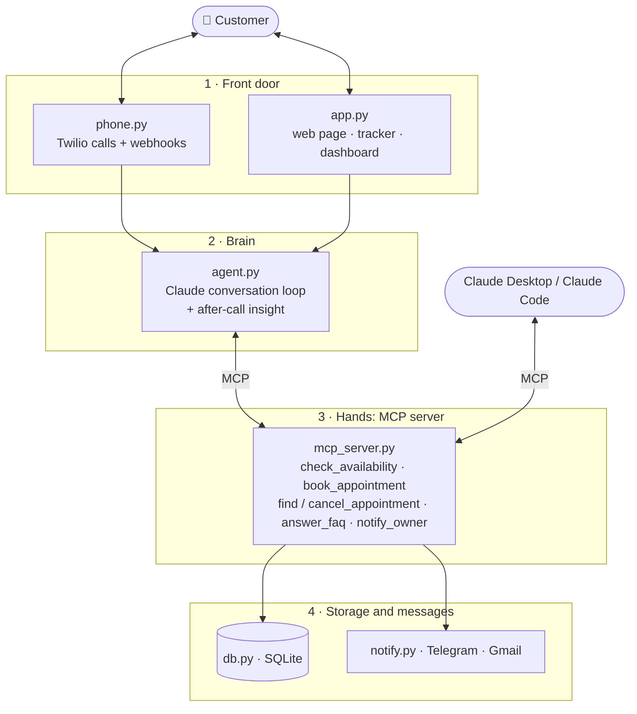
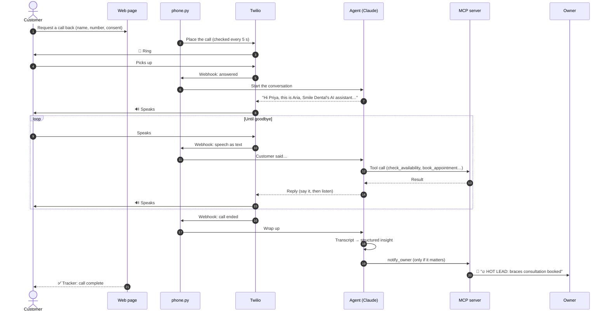

<div align="center">

# 📞 VoiceDesk

### An AI voice agent that calls your customers back, books appointments, and tells the owner what matters


-6a11cb?style=for-the-badge)

</div>

---

A customer leaves their number on a clinic's website. Within a minute, **Aria**, an AI receptionist, **rings their
phone**, answers their questions, and **books an appointment**. When the call ends, Aria writes a short insight,
and **only the calls that need attention** (a hot lead, an unhappy customer, an emergency) are pushed to the
owner's Telegram.

The demo business is a dental clinic, but the same pattern fits salons, restaurants, real estate, or any business
that loses leads because nobody calls back fast enough.

> **About this version.** VoiceDesk v1 is intentionally simple: about 1,300 lines of readable Python, built to show
> the complete idea end to end. Voice agent, MCP tools, phone calls, and owner alerts all work. It's designed to be
> extended, and the [roadmap](#-roadmap) lists the planned upgrades.

## ✨ Features

| | |
|---|---|
| 📱 **Real call-backs** | Aria calls the customer's phone through Twilio, speaks with a natural Indian-English voice, and listens |
| 🎧 **Browser call** | The same conversation in the browser, for anyone without a phone handy |
| 🤖 **Agentic tool use** | Claude decides when to check slots, book, cancel, or look up the FAQ; nothing is hard-coded |
| 🔌 **MCP server** | All tools are exposed over the Model Context Protocol, so Claude Desktop, Claude Code, or Cursor can use them too |
| 💬 **FAQ answers (RAG)** | Prices, timings, location, and insurance are answered from the clinic's own knowledge file |
| 🧠 **Call insights** | After each call: summary, outcome, mood, and lead score (hot / warm / cold) as structured output |
| 📲 **Smart owner alerts** | Only calls worth the owner's time reach Telegram; routine calls are logged on the dashboard |
| 📊 **Live tracker + dashboard** | Requested → calling you → on the call → summary; plus bookings, call log, and alerts |
| ✅ **Responsible by design** | Consent before calling, AI disclosure, call limits, masked numbers, signed webhooks |

## 🏗️ Architecture

Four simple layers, each in its own file:



**The key idea:** Claude never touches the database directly. It decides *what* to do and asks the MCP server's
tools to do it. Because the tools sit behind MCP, other AI apps can reuse them with no extra code. For example,
the owner can ask Claude Desktop *"What bookings do I have tomorrow?"*

## 🔄 How a call flows



### The same flow in the code

| Step | What happens | Where |
|---|---|---|
| **Startup** | Create tables, launch the MCP server and connect to it, start the call scheduler | `app.lifespan()` → `db.init_db()`, `ToolBox.start()`, `phone.scheduler_loop()` |
| **Request** | Clean the number, check consent and limits, save the request; the tracker polls every 2 s | `app.request_phone_call()`, `phone.can_call()`, `app.track_request()` |
| **Dial** | Ask Twilio to ring the customer, with webhook URLs for "answered" and "ended" | `phone.place_due_calls()` → `phone.place_call()` |
| **Talk** | Verify each Twilio webhook, pass the words to the agent, reply with TwiML (`Say` + `Gather`, or `Hangup`) | `phone.answer()`, `phone.turn()` |
| **Think** | Claude reads the conversation and tool list, calls tools over MCP until it has a reply, and uses `end_call` when done | `Receptionist._turn()` → `ToolBox.call()` → `mcp_server.py` |
| **Wrap up** | Transcript → `CallInsight` (structured output); alert the owner only if needed; save everything | `agent.wrap_up()`, `notify_owner`, `db.save_call()` |

The **browser call** uses the same brain and wrap-up. Only the voice changes: Groq Whisper and Edge-TTS
(`voice.py`) instead of Twilio.

## 🧰 Tech stack

| Part | Technology |
|---|---|
| AI agent | Claude Haiku 5.5 via the `anthropic` SDK: tool use and structured outputs |
| Tools | Model Context Protocol (`mcp`): MCP server and MCP client |
| Phone calls | Twilio Programmable Voice: outbound calls, TwiML, speech recognition, neural TTS |
| Browser voice | Groq Whisper (speech-to-text), Edge-TTS (text-to-speech) |
| Web app | Gradio on FastAPI and Uvicorn |
| Storage | SQLite |
| Notifications | Telegram Bot API, Gmail SMTP |
| Tunnel for webhooks | cloudflared |

## 📁 Project structure

```
├── app.py            # web page, live tracker, browser call, owner dashboard, server startup
├── agent.py          # the brain: Claude + MCP client, conversation loop, call insights
├── mcp_server.py     # the clinic's tools, served over MCP
├── phone.py          # Twilio: scheduling calls and handling webhooks
├── voice.py          # browser speech-to-text and text-to-speech
├── db.py             # SQLite tables and queries
├── notify.py         # Telegram and Gmail
├── config.py         # settings from .env
├── faq.md            # clinic knowledge the agent answers from
└── tests/
    └── test_flow.py  # end-to-end test with a scripted Claude (no keys needed)
```

---

## 🚀 Getting started

### 1. Install

Requires **Python 3.10+**.

```bash
git clone https://github.com/namburakhilbabu-alt/voicedesk-ai-voice-agent.git
cd voicedesk-ai-voice-agent
python -m venv .venv
```

| | Windows (PowerShell) | macOS / Linux |
|---|---|---|
| Activate | `.venv\Scripts\activate` | `source .venv/bin/activate` |
| Install | `pip install -r requirements.txt` | `pip install -r requirements.txt` |
| Settings | `copy .env.example .env` | `cp .env.example .env` |

Run the end-to-end test (no keys needed):

```bash
python tests/test_flow.py      # → ALL PASSED ✅
```

### 2. Configure

Add your keys to `.env`. Only Anthropic is required; each other service switches on one feature.

| Service | Unlocks | Keys | Cost |
|---|---|---|---|
| [Anthropic](https://console.anthropic.com) | The AI (**required**) | `ANTHROPIC_API_KEY` | About $0.005 per call |
| [Twilio](https://www.twilio.com/try-twilio) | Real phone calls | `TWILIO_ACCOUNT_SID`, `TWILIO_AUTH_TOKEN`, `TWILIO_PHONE_NUMBER` | Free trial credit |
| [cloudflared](https://developers.cloudflare.com/cloudflare-one/connections/connect-networks/downloads/) | Public URL so Twilio can reach the app | `PUBLIC_URL` | Free |
| Telegram ([@BotFather](https://t.me/BotFather)) | Owner alerts | `TELEGRAM_BOT_TOKEN`, `TELEGRAM_CHAT_ID` | Free |
| [Gmail app password](https://myaccount.google.com/apppasswords) | Booking confirmation emails | `GMAIL_ADDRESS`, `GMAIL_APP_PASSWORD` | Free |
| [Groq](https://console.groq.com) | Speaking in the browser call | `GROQ_API_KEY` | Free tier |

<details>
<summary><b>Setup steps for each service</b></summary>

**Anthropic:** sign up at [console.anthropic.com](https://console.anthropic.com), add a few dollars of credit, then
API Keys → Create Key → `ANTHROPIC_API_KEY`.

**Twilio**
1. Sign up at [twilio.com/try-twilio](https://www.twilio.com/try-twilio) (you verify your own mobile number).
2. Console → **Get a phone number**, then copy the **Account SID**, **Auth Token**, and number into `.env`.
3. To call Indian numbers, search the Console for **Geo permissions** and enable **India**.
4. Trial accounts can only call **Verified Caller IDs** and play a short trial message before the call starts.

**cloudflared:** install it (`winget install --id Cloudflare.cloudflared` or `brew install cloudflared`), run
`cloudflared tunnel --url http://localhost:7860`, and put the printed `https://….trycloudflare.com` address in
`PUBLIC_URL`. The address changes each time cloudflared restarts.

**Telegram**
1. Message **@BotFather** → `/newbot` → copy the token into `TELEGRAM_BOT_TOKEN`.
2. Open your bot, press **Start**, send any message.
3. Open `https://api.telegram.org/bot<TOKEN>/getUpdates`; the number after `"chat":{"id":` is `TELEGRAM_CHAT_ID`.
4. Set `OWNER_ALERTS=all` to receive every call, not only the important ones.

**Gmail:** turn on 2-Step Verification, create an app password at
[myaccount.google.com/apppasswords](https://myaccount.google.com/apppasswords), and set `GMAIL_ADDRESS` and
`GMAIL_APP_PASSWORD`.

**Groq:** sign up at [console.groq.com](https://console.groq.com) → API Keys → `GROQ_API_KEY`.

</details>

### 3. Run

```bash
python app.py                                      # → http://localhost:7860
cloudflared tunnel --url http://localhost:7860     # second terminal, for phone calls
```

Open **http://localhost:7860**, enter your name and number, tick the consent box, and click
**📞 Request a call back**. Your phone rings within about 10 seconds.

Try this conversation:
> *"Yes, now is fine."* → *"I'm thinking about getting braces. How much do they cost?"* →
> *"Do you have something tomorrow evening?"* → *"6 PM works."* → *"No, that's all. Thanks!"*

The tracker reaches **Call summary**, Telegram receives a 🔥 hot-lead alert, and the **Owner dashboard** tab shows
the booking, call log, and alert.

### 4. Connect the MCP server to Claude

**Claude Code**
```bash
claude mcp add voicedesk -- /full/path/to/.venv/bin/python /full/path/to/mcp_server.py
```

**Claude Desktop** (Settings → Developer → Edit Config)
```json
{
  "mcpServers": {
    "voicedesk": {
      "command": "/full/path/to/.venv/bin/python",
      "args": ["/full/path/to/mcp_server.py"]
    }
  }
}
```
Then ask: *"What bookings do I have tomorrow?"* or *"Summarize today's calls."*

<details>
<summary><b>🛠️ Troubleshooting</b></summary>

| Problem | Fix |
|---|---|
| *"ANTHROPIC_API_KEY is not set"* | Keep `.env` next to `app.py` and restart the app after editing it |
| Mic doesn't record | Open `http://localhost:7860` (not an IP address) and allow microphone access |
| *"Phone calls are not set up"* | Set all three `TWILIO_*` values and `PUBLIC_URL`, then restart |
| Twilio error about unverified numbers | Trial accounts can only call Verified Caller IDs |
| Twilio error about geo permissions | Enable the destination country under Geo permissions |
| Phone says *"an application error has occurred"* | `PUBLIC_URL` is outdated (cloudflared restarted) or the app isn't running |
| No Telegram message | Message your bot first and check the chat ID; routine calls need `OWNER_ALERTS=all` |
| Port 7860 in use | Add `PORT=7861` to `.env` |

</details>

---

## 🗺️ Roadmap

v1 keeps things simple so the whole system is easy to follow. Planned upgrades:

- [ ] **Real-time streaming voice:** Twilio Media Streams with streaming speech-to-text and text-to-speech, for
  sub-second replies and the ability to interrupt Aria mid-sentence
- [ ] **Hindi and Hinglish conversations,** with Indian-language voices
- [ ] **Indian caller ID:** a registered 160-series number with DLT compliance through an Indian telecom provider
- [ ] **WhatsApp confirmations and reminders** instead of email
- [ ] **Calendar sync** with Google Calendar or the clinic's booking software
- [ ] **Smarter RAG:** embeddings and a vector store instead of keyword search
- [ ] **Multi-business setup:** one deployment serving many clinics, each with its own FAQ, hours, and owner
- [ ] **Cloud deployment** with Docker, Postgres, and a hosted demo
- [ ] **Conversation quality evals:** scripted test calls scored automatically

## 🔒 Responsible use

VoiceDesk asks for consent before calling, introduces Aria as an AI assistant, limits calls per day and turns per
call, masks phone numbers on the dashboard, verifies every Twilio webhook signature, and keeps owner-only MCP
tools away from the agent. A production deployment in India would also need a registered calling number, DLT
registration, calling-hours limits, and DPDP Act compliance.

---

<div align="center">

Built by **[Akhil Babu Nambur](https://github.com/namburakhilbabu-alt)** · Questions and ideas welcome via issues

</div>
